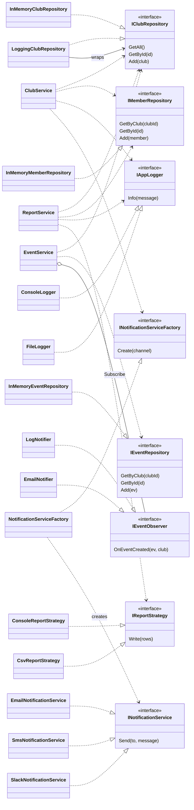

# Sơ đồ lớp sau khi refactor (Ch02)

Các service chỉ phụ thuộc vào interface. `Program.cs` là nơi duy nhất tạo đối tượng cụ thể rồi đưa vào constructor.

## Pattern nằm ở đâu

| Pattern | Thành phần |
|---------|------------|
| Factory | `INotificationServiceFactory`, `NotificationServiceFactory` tạo `INotificationService` theo `NotificationChannel` |
| Decorator | `LoggingClubRepository` bọc `IClubRepository` để ghi log |
| Strategy | `IReportStrategy` với `ConsoleReportStrategy` và `CsvReportStrategy`, dùng trong `ReportService.Generate` |
| Observer | `EventService` báo cho các `IEventObserver` (`LogNotifier`, `EmailNotifier`) khi tạo sự kiện |
